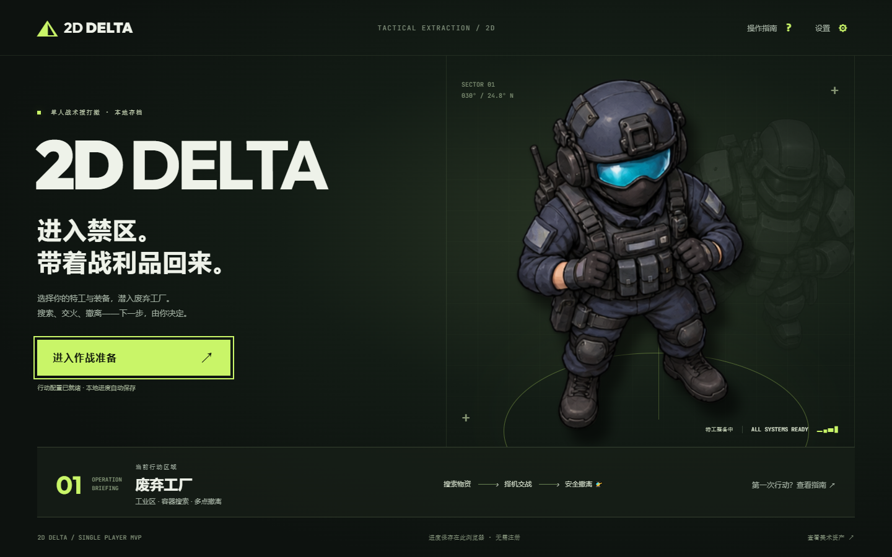
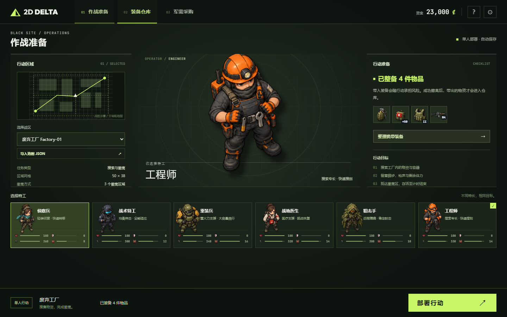

# 2D Delta

俯视角 2D 单机搜打撤游戏。选择特工、准备装备、进入工厂搜索物资，与 AI 交战后前往撤离点，将战利品带回仓库。

本仓库由当前项目源码独立初始化，拥有新的 Git 历史，**不是 fork**。当前版本无需账号、无需服务端，进度保存在当前浏览器。



## 启动

安装 [Node.js 22 或更新版本](https://nodejs.org/)，在仓库根目录运行：

```sh
npm ci
npm run dev
```

打开终端显示的本机地址，默认是 **http://127.0.0.1:5173/client/**。点击“进入作战准备”，选择特工后即可部署；也可以先去军需采购，再到装备仓库携带物品。空装出发使用特工的基础武器。

游戏使用原生 JavaScript、Canvas 2D 和 ES Modules，运行时不依赖框架、数据库或 .NET。请通过 HTTP 打开页面，以便读取地图和配置。

## 当前可玩内容

- 军事风格首页、作战准备、装备仓库、军需采购，以及统一的战术 HUD、暂停、背包和行动结算。
- 6 名特工、8 种武器、7 类 AI；枪械使用各自的射程、弹匣、换弹计时、射击模式和穿透参数。
- 工厂地图包含容器、地面物资、匹配颜色的钥匙柜、巡逻敌人，以及 2 个免费出口和 1 个付费出口。
- 每次行动限时 10 分钟；撤离默认需要存活 10 秒，受击重置计时，离开区域取消。工厂付费出口需 ₡3,000，费用只在成功结算时扣除。
- 药品需要读条；移动、开火、切枪、换弹或受击会打断治疗。手雷有飞行、碰撞与引信，并会伤及自身。
- 体力只在实际冲刺移动时消耗。耗尽后需恢复到至少 20% 并松开 Shift，才能再次冲刺；搜索时也正常恢复。
- 局内可从背包装备和更换枪械、护甲、背包；换装保留剩余弹匣与护甲耐久，满包无法容纳旧装备时不执行交换。
- 四档护甲维修包分别恢复 40 / 80 / 120 / 180 耐久，耗时 8 / 7 / 6 / 5 秒；完成才消耗，移动、开火、换装或受击会中断。
- 背包与容器采用真实矩形占格，支持 1×1、1×2、2×2、2×3、3×3、3×4 等尺寸，可旋转、整理。特工基础容量 24–36 格，穿戴背包增加 12 格，装备位与物品空间分开。
- **2×2 格保护栏**可放能容纳的贵重品、钥匙、药品和维修包。阵亡、超时、放弃或刷新保留保护物品；药品和维修包需取出后使用。
- 撤离带出物资先入仓库，出售时获得资金；贵重品按标价出售，其余物品为标价的 40%。当前没有固定撤离奖金。
- 51 种物资、23 项采购，增加显卡、军用电脑、发电机、金条等 20 种战利品。73 项图像覆盖角色、敌人、枪械、全部物资与场景，界面与地图编辑器取消 Emoji，缺图使用中性后备图。
- 首页、大厅与部署流程增加过渡动画，跟随真实加载进度，支持减少动画。仓库采用每页最多 16 件的占格网格，支持跨页选择。
- 可导入自定义地图；[地图编辑器](tools/map-editor.html)位于同一服务的 `/tools/map-editor.html`。



## 操作

| 操作 | 按键 |
|---|---|
| 移动 / 冲刺 | WASD / Shift |
| 瞄准 / 开火 | 鼠标 / 左键 |
| 搜索、交互、拾取 | F |
| 附近物品 | H |
| 换弹 / 切枪 | R / 1、2 |
| 背包与保护栏 | Tab |
| 使用药品 / 投掷手雷 | 4 / G |
| 暂停 / 继续 | Esc |

按 Tab 后点击物品，在详情区选择装备、修复护甲、使用、旋转或放入保护栏。点击装备位“卸下”放回背包；保护物品可“取出至背包”。切换到后台会自动暂停单机行动。

## 存档与设置

进度使用 `2d_delta_save_v1`，设置使用 `2d-delta-settings`。从旧版本存档迁移时保留资金、仓库和装备，并去除旧身份字段。迁移仅发生在**同一站点来源**中；不同端口、浏览器或设备不会自动共享。

购买、装备、出售、保护栏和结算只有在保存成功后才生效。结算保存失败时请保持页面开启并重试；损坏存档会显示恢复入口，不会直接覆盖。重置损坏存档需要明确确认。

设置中的音效、屏幕震动、紧凑 HUD 和减少动画会立即应用并保存。当前不包含登录、房间、匹配、多人服务或云端同步。

## 验证

```sh
npm run check
npm test
```

`npm test` 包含 93 项模块检查和 32 组真实主流程模块回归；Node 的测试汇总将后者作为一个测试文件显示。浏览器检查单独运行：

```sh
npx playwright install chromium
npm run test:browser
```

使用已安装的 Chrome 时，可在 PowerShell 中设置 `$env:PLAYWRIGHT_CHANNEL='chrome'` 后运行浏览器检查。`npm run test:assets` 也运行同一套浏览器验收，包含资产覆盖和透明度检查。

当前证据记录在 [MVP 验收与修复](docs/mvp/verification.md)、[主流程结果](docs/mvp/game-results.json)和[浏览器结果](docs/mvp/browser-results.json)。已验证桌面 Chrome 的 18 组真实操作流程，并检查 1440、1366、1024 宽度。手机触控和长时间性能尚未实测。

## 开发资料

- [局内装备、维修与占格背包验收](docs/inventory-2026-10-18.md)
- [开发路线与完成项](ROADMAP.md)
- [项目协作约定](AGENT.md)
- [Delta Force 官方参考与 2D 转译](docs/mvp/reference.md)
- [体力与移动规则](docs/mvp/movement.md)
- [简化战斗规则](docs/mvp/combat.md)
- [图像资产来源、映射与生成提示](client/assets/README.md)
- [独立仓库初始化记录](docs/initialization/README.md)
- [历史资料说明](docs/HISTORY.md)

玩法循环、信息层级和军绿色视觉参考 Delta Force 的 Operations；像素射程、体力速率、治疗时长、伤害公式、保护栏容量与撤离费用属于本项目的 2D 单机平衡选择，详见对照文档。MVP 没有实现原作的完整伤病、改枪、任务和经济系统。
