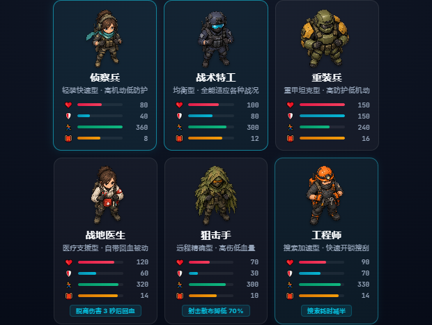
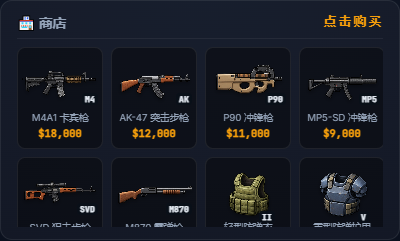
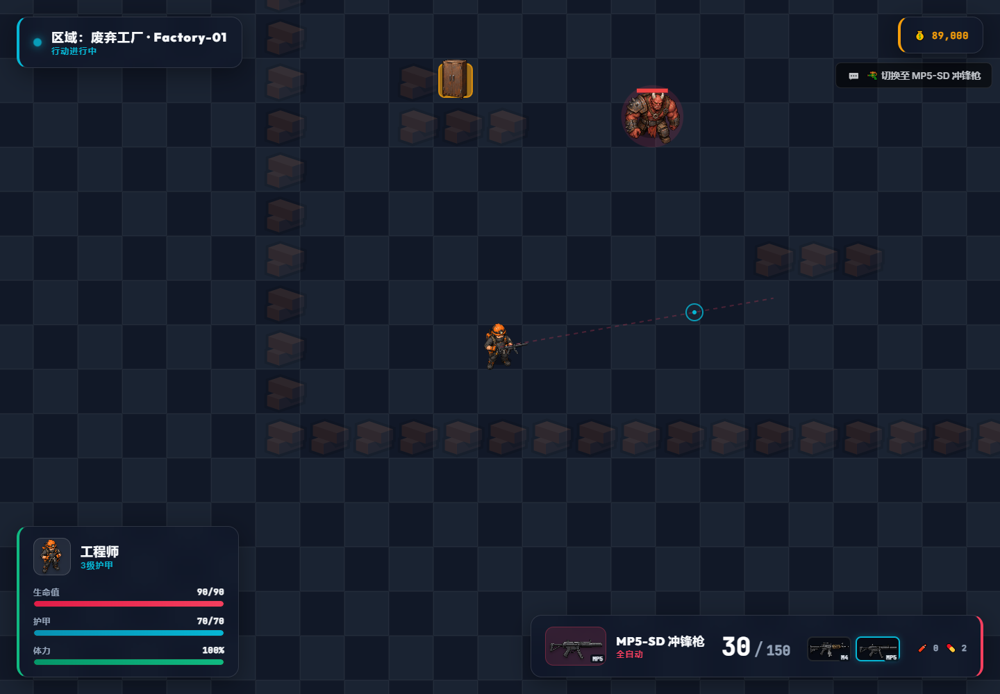
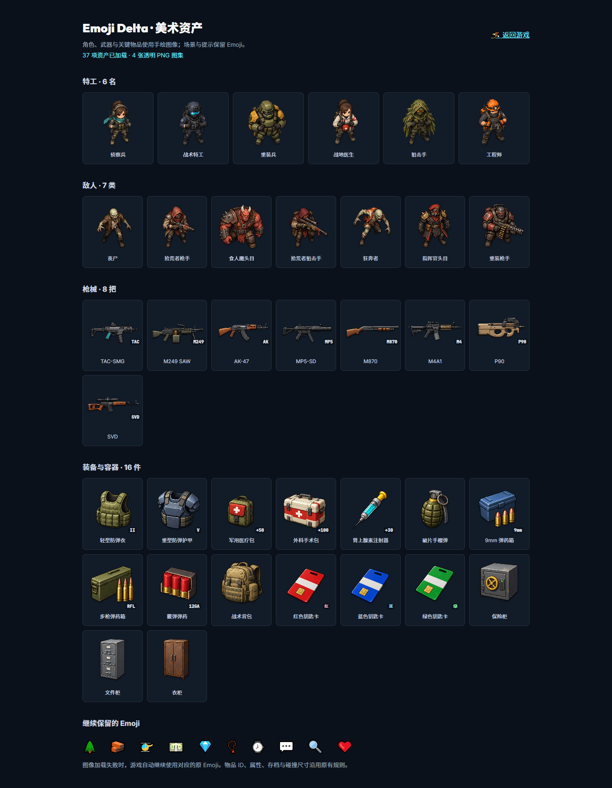

# 美术资产接入与验证

日期：2026-10-17。

## 完成内容

使用用户指定的 imagegen 技能，通过内置 `image_gen` 工具制作并接入 4 张透明 PNG 图集，共 37 项资产：6 名特工、7 类敌人、8 把枪和 16 件装备/容器。文件、排列和完整提示词见 [资产说明](../../client/assets/README.md) 与 [prompts.json](../../client/assets/prompts.json)。

角色、枪械及需要区分的物品使用图像；树木、墙体、撤离、现金、钻石、首饰、状态与通知继续使用 Emoji。大厅、商店、仓库、HUD、背包、附近物品、容器物品、撤离结果和战局使用同一份资产映射。新增预览页也可从大厅底部进入。

新模块按定义 ID 或地面物品 `type` 解析图像，兼容原存档。默认武器保留配置 ID，使侦察兵的 MP5、重装兵的 M249 等在没有购买武器时也能显示正确图像。图像加载独立于游戏启动，单张图集缺失只影响该类图像，继续显示对应 Emoji。

图像取样适配实际生成结果：修正特工行间、P90/SVD 之间和钥匙卡/柜体之间偏离均匀网格的边界；Canvas 与 CSS 使用一致的取样区域并保持原图比例。特工手持枪械独立绘制，可随切枪和鼠标瞄准更新。

## 验证结果

- 原客户端玩法回归：17/17 组通过，验证经济结算、药品、弹药、装备容量、输入、搜索、地图和 HUD 等行为。
- Chrome 真实浏览器检查：9/9 组通过，结果见 [browser-results.json](browser-results.json)。使用隔离的浏览器档案、真实页面和模块，测试期间启动回环 HTTP 服务，结束时关闭服务与浏览器。
- 4 张 PNG 均含有效 RGBA 透明通道。全部 37 个 Canvas 取样区域含非空图像与透明像素；校验蓝/红钥匙卡底部不混入下一行柜体。
- 所有配置中的特工、敌人、枪械和商店商品均有图像；原 ID 存档可直接显示。不同特工的默认枪械保留正确图像 ID。
- 实际操作覆盖：进入大厅、切换特工、购买 P90、装备医疗物品、部署、开火、切换两把枪、打开背包及 HUD 头像更新。
- 图集 404 检查覆盖：武器图像回退为 Emoji，其他图集正常显示，可以登录和部署，绘制接口明确返回未绘制状态。
- 连续更新 60 次 HUD，不重建未变化的图标节点。正常浏览器流程未观察到 JavaScript 或控制台错误。
- 预览页显示全部 37 项，页面可滚动至底部，390px 宽度没有水平溢出。
- JavaScript 语法和 Git 差异空白检查通过。

浏览器检查是桌面 Chrome 的本地单机体验。此次没有修改或重新验证 C# 服务端，也没有接入多人联机。

## 复现

在仓库根目录运行原客户端回归：

```powershell
node --experimental-vm-modules docs/fixes-2026-10-02/client-regression.cjs
```

浏览器脚本需要可解析的 `playwright` 包和本机 Chrome，使用现有依赖，不要求游戏安装 npm 包：

```powershell
node docs/assets-2026-10-17/browser-smoke.cjs
```

依赖位于独立的共享目录时，先把该目录设为当前进程的 `NODE_PATH`。脚本自动选择空闲的本机回环端口，不占用固定端口，也不读取用户真实 Chrome 档案。

## 截图








