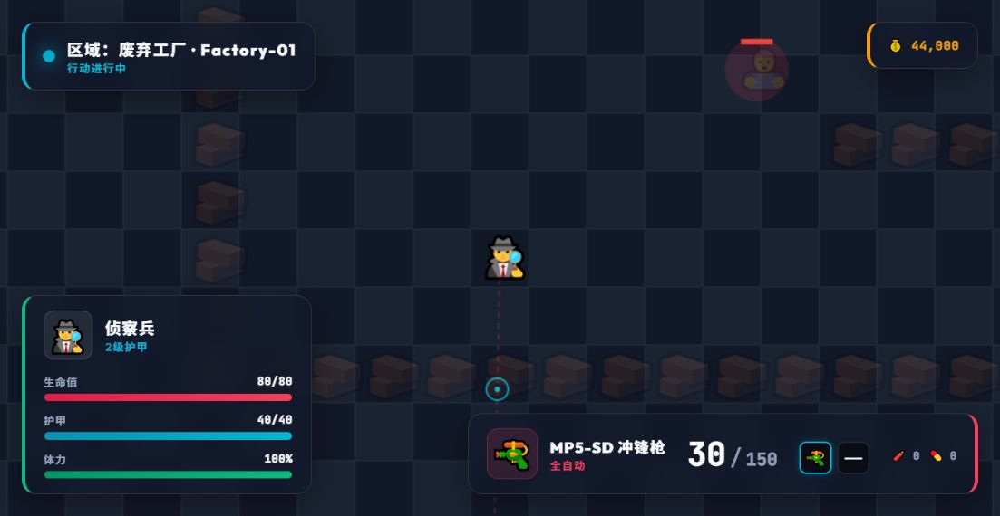

> 历史资料：此文档记录旧版本；当前单机 MVP 的功能、启动方式与验收以根目录 README 和 docs/mvp/ 为准。

# P1 / P2 修复与验证

日期：2026-10-02。对应原审查报告 B01～B12 和 S02；同时修复联机上线阻断项 S01 的客户端 dt 信任问题。

## 修复结果

| 编号 | 改动 | 主要验证 |
|---|---|---|
| B01 | 携带的钥匙卡进入局内背包；容器读取 requiredKey，工厂三个保险柜分别匹配蓝/绿/红卡，商店补充红卡 | 三色匹配可搜索，错误颜色无法开锁 |
| B02 | 部署预留装备，使用行动 ID 原子结算；战利品入库，金币只增加 $5,000 撤离奖励；保留未消耗的带入装备 | 蓝钻撤离后余额 $55,000，出售获得 $14,000，最终 $69,000；重复结算不加钱、不重复入库 |
| B03 | 战局有明确结束状态；致命伤优先于撤离，结束后停止更新与输入 | 最后撤离帧受到致命攻击，仅阵亡，无奖励 |
| B04 | 快捷键只在行动中生效，跳过可编辑控件；失焦/隐藏/聚焦输入框清空输入；单次动作忽略按键重复；鼠标开火只接收游戏画布 | 输入框、重复按键、失焦、页面隐藏、界面点击和画布点击 |
| B05 | 药品按具体定义恢复 50/100/30 HP，消耗实际物品；拾取药品不自动回血；背包点击可使用具体药品；手雷按库存计数与消耗 | 大药包恢复 100 HP、注射器恢复 30 HP、拾取后点击治疗、拾取手雷后投掷 |
| B06 | 特工通过 weaponId 引用武器配置；弹药按类型共享，补给按 ammoAmount 应用，可用于第二把枪；已使用弹药箱不作为战利品保留 | 默认枪弹药类型、步枪补给 90 发、切枪后共享备弹 |
| B07 | 两把枪各自持有冷却、换弹进度和弹匣；后台继续换弹，共享备弹在装弹时扣除 | AK 换弹期间切 M870 不继承倒计时；两把枪同时换弹不会复制备弹 |
| B08 | 医生脱离伤害 3 秒后按配置回血；狙击手散布乘 0.3；工程师容器/背包搜索耗时减半 | 医生延迟回血、狙击手静止与移动散布、工程师搜索耗时 |
| B09 | F 和 H 使用同一拾取入口，背包搜索完成前无法拾取，内容只生成一次；移动中断搜索 | 重复 F、H 点击无法绕过搜索，完成后不重复生成物品 |
| B10 | 容器拾取校验距离、视线、当前行动及实体归属；战局结束和重新部署清空面板及引用 | 远程、隔墙、旧行动容器无法拾取；近距离正常拾取 |
| B11 | 大厅和战局统一计算容量：特工基础格数 + 一个背包的 4 格；限制两枪、一甲、一个背包；超容量禁止部署；贵重品不能装备 | 大厅容量即时变化，卸下恢复，重复装备和超容量被拒绝，仓库超过 64 件仍展示 |
| B12 | 当前地图提供实际宽高与图块尺寸；移动、渲染与随机生成使用当前地图；大厅增加 JSON 文件导入；加载失败保留装备 | 6400px 宽地图右半区域可移动、边界正确，导入处理器和自定义地图名，非法地图被拒绝 |
| S01 | 网络消息只提交经过校验的输入，移动、冷却、换弹、撤离由固定 60Hz Tick 推进；检查 seq、消息频率、数值及大小，处理分片并清理过期持续输入 | 非法 dt/字段、重复与过期 seq、输入洪泛不能加速，换弹由 Tick 完成，超时停止移动与射击 |
| S02 | 服务端 Lobby/InRaid/Dead/Extracted 状态；死亡/撤离只触发一次；事件含 playerId，仅向对应玩家发送；每个连接有独立发送队列 | 10 秒撤离、致命伤优先、受击重置、离区取消、其他玩家不收到个人结果、分片与发送顺序 |

## 同步处理的体验问题

- HUD 体力按当前/最大体力归一化，满体力统一显示 100%；区域名读取当前地图，武器显示真实射击模式。
- 自动武器支持按住开火，M870/SVD 每次按下只射击一次。
- 附近物品距离标为 px，列表保持稳定，只在物品集合变化时重建，更新距离不会每帧替换点击目标。
- 购买、装备、地图导入和部署失败在大厅显示反馈；装备错误解除后清除过期提示。
- 工厂原本放在墙格 (4,30) 的衣柜移动至空地 (4,29)；导入地图拒绝放在阻挡格上的容器。
- 结算存储写入失败时停止战局，保留原页面并显示“重试保存”；重试仍受行动 ID 约束，不会重复奖励。
- README 同步药品按键 4、结算方式、被动、装备限制、地图导入和当前单机范围。

## 自动验证

| 检查 | 结果 |
|---|---|
| 客户端断言回归 | 17 / 17 组通过 |
| 服务端断言回归 | 12 / 12 组通过 |
| C# 服务端构建 | 成功，0 警告、0 错误 |
| 客户端 JSON 解析 | 通过 |
| 客户端 ES 模块与地图编辑器脚本语法 | 通过 |
| git diff --check | 通过 |

客户端执行真实游戏、经济、HUD、输入及大厅模块，使用替代 DOM、存储、音效、绘制和调度器，并通过内存副本注入可控战局。每次模拟更新不超过 0.1 秒。服务端执行真实消息处理、固定 Tick 与目标事件队列，清空随机地形，使用内存 WebSocket 验证分片、消息大小、断开清理及发送顺序；没有启动 HTTP 监听。

从项目根目录运行：

```powershell
node --experimental-vm-modules docs/fixes-2026-10-02/client-regression.cjs
dotnet run --project docs/fixes-2026-10-02/server-regression.csproj
```

本机升级后的 SDK 为 9.0.318，项目仍使用 net8.0。本次构建利用已有 8.0.20 引用包缓存及已安装的 .NET 8 运行时，没有更改项目目标框架或安装依赖。当前机器可用以下命令复现完整检查：

```powershell
./docs/fixes-2026-10-02/verify.ps1 -UseCachedNet8References
```

- [客户端结果](client-regression-results.json)
- [服务端结果](server-regression-results.json)
- [客户端回归脚本](client-regression.cjs)
- [服务端回归脚本](ServerRegression.cs)

## 浏览器体验验证

使用独立临时 localhost 端口与测试档案，在 Chrome 中完成进入大厅、购买背包、装备背包和工厂地图部署。装备背包后，大厅容量即时从 8 变为 12；余额从 $50,000 变为 $44,000；购买与装备反馈可见。部署后显示工厂地图名、MP5-SD、30/150 弹药和 100% 体力，未观察到页面控制台警告或错误。



真实文件选择器导入的浏览器检查未完成：当前 Chrome 扩展没有文件 URL 访问权限，阻止自动化工具设置选中文件。未修改扩展权限。地图文件读取处理器、验证、导入列表、自定义名称和宽地图移动已通过 VM 回归；该结果与真实文件选择器检查区分记录。

## 使用行为与范围

部署会预留带入装备；死亡和行动中刷新/关闭页面会失去这批装备。成功撤离只恢复未消耗的装备，新增战利品进入仓库，之后出售才获得售价。原有本地档案、金币和仓库沿用，已有多个背包/护甲或超容量的旧装备需要在大厅先卸下整理。

本次完成的是审查报告中的 P1/P2 及 S01 修复。浏览器仍是单机本地模拟，C# 服务器尚未与浏览器客户端接通；统一前后端地图、服务端账号认证、数据库、快照与预测属于多人系统后续工作，未将它们视为本次已实现的能力。
