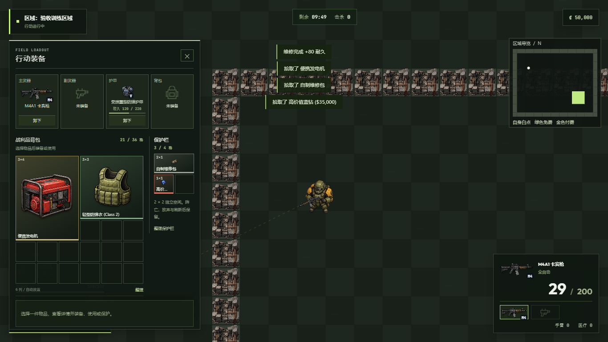

# 2026-10-18 局内装备、维修与矩形背包验收

本轮在独立仓库 2D-Delta 中完成。当前玩法为浏览器本地单机；旧 Emoji-Delta 仓库未修改。

## 实际操作

按 Tab 打开行动装备，点击背包中的枪械、护甲或背包，在下方详情区选择“装备主武器 / 装备副武器 / 装备护甲 / 穿戴背包”。装备位的“卸下”将该件放回背包。换装前先检查旧装备和剩余物品能否完整放下；空间不足时维持原有装备与物品。

武器使用独立实例保存弹匣与冷却。拾取后换装、卸下重装不会补满弹匣或增加备弹；基础武器不能变成可出售物资。每件护甲保存实际剩余耐久，更换同型号护甲也不会串用耐久。成功撤离时，身上装备进入大厅装备位，背包中的新战利品进入仓库，带入且未消耗的物资恢复携带；同一物品不会重复入仓。

## 维修

| 维修包 | 恢复耐久 | 读条 | 默认占格 | 采购价 |
|---|---:|---:|---|---:|
| 自制维修包 | 40 | 8 秒 | 1 × 2 | ₡1,500 |
| 标准维修包 | 80 | 7 秒 | 2 × 2 | ₡4,000 |
| 精密维修包 | 120 | 6 秒 | 2 × 2 | ₡7,500 |
| 高级维修包 | 180 | 5 秒 | 2 × 3 | ₡12,000 |

在背包中选择维修包，点击“修复护甲”。需要实际装备护甲且耐久未满；完成时消耗一个实例，修复不超过该件上限。移动、开火、受击、切枪、换弹、换装、卸装或移动该维修包到保护栏会中断；中断不消耗。暂停冻结进度。读条绑定护甲实例，更换成同型号的另一件也不能错误获得修复。

四档恢复量、时长、售价、占格和“不降低最大耐久”是本项目的单机平衡选择，不代表 Delta Force 官方数值或完整维修效率公式。官方装备/护甲概念参考 [Operations Mode 101](https://deltaforce.garena.com/en/news/system/RMDWVM)，维修系统参考 [官方更新说明](https://deltaforce.garena.com/en/news/announcement/V6J38U)。

## 容量与物资

- 背包固定 6 列，特工基础容量分别为 24 / 30 / 36 / 30 / 24 / 30 格；一个已穿戴背包增加 12 格。装备位与背包分开，卸下的枪械、护甲和背包按其真实形状占格。
- 物品支持 1×1、1×2、2×1、2×2、2×3、3×3、3×4 和长枪形状；检查完整矩形能否放入，空余总格数足够也可能放不下。选择非正方形物品可旋转 90°，也可使用“整理”自动排列。
- 保护栏为独立 2×2 格，贵重品、钥匙、药品和能放下的维修包可放入。标准维修包占满 4 格；高级维修包占 6 格，无法放入。保护栏内药品和维修包需要先取出使用。每次转移与保护栏排布变更先成功保存再修改局内物品。
- 容器显示自己的矩形网格：保险柜 4×4、文件柜 6×4、衣柜 6×6。搜索只生成一次且不超出容器容量；单件和全部拾取逐件校验背包形状，未放下的物品留在容器。
- 仓库每页最多显示 16 件，按尺寸铺在 8 列网格中，支持跨页选择。“全选本页”范围明确；旧档超量携带仍提供卸下入口。
- 弹药维持原有单机补给规则：拾取或带入后转为对应类型的共享备弹，局内不作为可换装的物品；换装不会凭空生成备弹。
- 新增 20 种工业、电子、科研与贵重战利品，物品定义总计 51 种，采购总计 23 项。包括显卡、处理器、军用电脑、频谱仪、发电机、氧气瓶、金条、相机和显微镜等。

## 美术与过渡

保留已有可区分的角色与枪械图像，新增 3 张透明 PNG 图集，共 36 张图；现在 73 项图像、7 张图集。游戏 DOM、Canvas、资产预览与地图编辑器不再显示 Emoji。缺图使用中性线框或几何后备图形。旧地图/存档的 emoji 字段仅作兼容元数据，不参与画面。

首页/大厅切换增加淡出与位移动画；部署遮罩跟随真实地图读取、装备验证和进入战局的流程。成功和失败均释放输入，无人为固定等待。支持系统和游戏设置中的减少动画；快速往返不会留下不可点击的隐藏面板。

原始生成图、完整提示词、裁切与哈希记录见 [美术记录](art-2026-10-18/README.md)及[提示词](art-2026-10-18/prompts.json)。

## 验证与边界

| 验证 | 结果 |
|---|---|
| 静态检查 | 33 个 JS 文件、5 组配置、地图、7 张 RGBA 图集和文档链接通过 |
| 模块检查 | 93 项通过；含 15 项排布测试与 250 组确定性排布压力样本、20 项经济/设置检查 |
| 真实 ES 模块主流程 | 32 组通过；DOM、存储、调度等环境由测试替代，无生产调试接口 |
| 真实 Chrome | 18 组通过；公开 UI、独立存档、导入地图、真实 Canvas 和输入，计时使用 Playwright clock |
| 视觉与独立复核 | 首页/仓库/局内背包/容器；1366×768 和 1024×768 无矩形重叠；73 图可渲染并透明 |
| 独立边界审查 | 同型号两把枪与不同耐久护甲换装、卸下、撤离数量守恒；弹匣与耐久保留，保护维修包刷新不重复 |

浏览器覆盖实际开火后 M4A1 弹匣 30→29→卸下重装仍为29，受损重甲40/220→换轻甲→换回仍40/220，标准维修被移动打断保留包，完整读条后120/220，以及旋转、2×2保护、容器拾取和减少动画。正常流程未捕获 JavaScript 或控制台错误。

原有暂停/放弃、死亡、刷新、付费撤离、超时、钥匙、搜索、体力和存档失败流程也已回归。浏览器检查的临时回环服务在结束后关闭；用户已登记的持续预览继续使用原5173服务。

[主流程结果](mvp/game-results.json)、[浏览器结果](mvp/browser-results.json)、[资产检查](art-2026-10-18/verification.json)。未验证手机触控、长时间压力与真实多人行为；当前没有实现自由拖拽摆放、耐久上限磨损或维修包多次剩余用量，交互为点击详情、旋转与自动整理。
